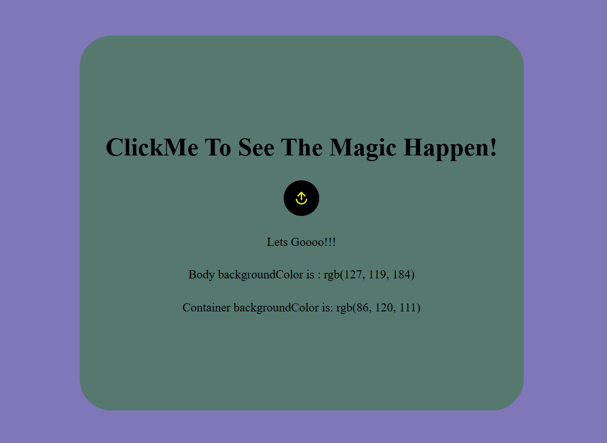

# Random Color Changer

A simple web application that generates random RGB colors for the page background and a container with the click of a button.

## Screenshot



## Features

- Generate random RGB colors.
- Change the page background color.
- Change the container background color.
- Display the current colors.
- Simple and responsive interface.

## Built With

- HTML5
- CSS3
- JavaScript

## Getting Started

1. Clone the repository:

   ```bash
   git clone https://github.com/oussama-dalhi/random-color-changer.git
   ```

2. Open the project folder.
3. Open `index.html` in your browser, or use VS Code Live Server.


## License

This project was created for learning and practice.